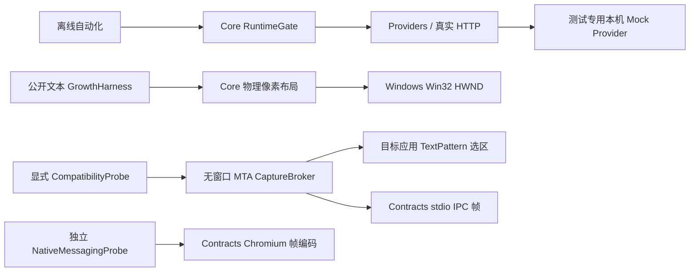

# 当前实际架构与生产缺口

本文件描述已落地的 P0 切片；正式产品仍以 SPEC 的模块和阶段为准。

- Core：纯状态/身份门控与布局，net10.0，无 WPF、模型请求或用户内容持久化。请求替换/停用取消旧身份；实际每次发送由统一门控原子启动，响应再检查身份。还未交付完整多任务 coordinator/会话版本库。
- Contracts：内部 IPC 和 Chromium Native Messaging 是两个独立编码器，先校验无符号长度再分配。图像重组属于单连接串行所有权，有界内存、索引、摘要与 30 秒绝对截止；Commit 仅交付字节，不启动模型。NativeHost接收角色已有Windows ACL/session/进程/安装角色核验代码，真实Windows验证NotRun；其他角色的生产IPC仍未完成。
- ImageChunkWire：规范 Chunk 外壳、190KiB 原始分片、完整 UTF-8 消息再限界，严格 ID/索引/字段/base64 验证后进入重组；错误清除未完成传输。整条 JSON→解码→20MiB 重组→摘要 Commit 已离线验证，浏览器 NativeHost 与图像像素/格式验证仍未接入。
- Providers：每请求独立凭据头，禁自动重定向；双协议 JSON/SSE、有限重试、总/首包/空闲截止、输出限界与晚到门控。Anthropic 按开始/活动块/最终原因/结束校验，只暴露 text 块。SecretLease 仅内存访问，不替代 DPAPI；端点风险设置、能力选项、完整错误 UI 和两阶段图片流水线尚未接入。
- 接收合同：产品消费应使用 GenerateEnvelopesAsync，将完整 RequestIdentity 与每个事件一起放入 ProviderEventReceiver。目标 SynchronizationContext 由宿主提供；队列实际执行时通过 Core.TryApply 原子检查身份并应用，不能只在入队前检查。应用回调必须短小同步、不等待或再次跨线程 dispatch。当前已有队列与真实 HTTP 集成测试，正式 WPF App 尚未交付，不能将合同测试称为 UI 验收。
- 信封入口在身份锁内关联任务与调用方取消，防止当前 CTS 被并发替换/释放的竞态；调用方不传令牌也默认响应 Off/Stop/Lock/换文取消。低层 GenerateAsync 的调用方自行关联取消，只用于受控传输/故障测试或明确管理生命周期的代码，不能绕过完整接收边界接入 UI。
- Windows：Win32 坐标/监视器/窗口 Region/完整性级别实际 PInvoke。WPF 及 UIA 属于 Windows 框架，桌面实际验证不能由交叉编译代替。
- CaptureBroker：当前为 P0 一次性进程协议，真实 UIA 在 MTA 获取；父进程以硬终止处理无法取消的 COM 阻塞。仍需连接生产采集手势、状态 epoch、长驻 broker 重启/熔断、授权复制兼容与安全 IPC。
- tools：Mock Provider 只供测试；GrowthHarness 是公开固定文本视觉实验；CompatibilityProbe 对公开文件实际选区比对；NativeMessagingProbe 是显式 echo 实验。均不作为完整快译 App 的替代品。生产项目不引用测试工具。

解决方案现有 19 个实际可构建项目。未创建空 App/Shell/OCR/扩展接口来冒充完成：正式 WPF App、托盘/设置/热键/DPAPI、生产 OLE、浏览器扩展/NativeHost、完整安装与生产图片管线仍是明确待实现模块。新增App的P0实验入口、ImageWorker实际调用代码、原生Shell源码与开发身份工程见下；原生构建/Windows行为未验证。P0 真实平台退出门槛与其必要的 Windows/原生工具链证据仍为 Blocked。

可运行的检查及失败修复见 progress.md，Windows 操作和限制见 windows-probes.md，176 个规格条目见 traceability.json。所有 A—L 整体用例保持 NotRun。

## OLE 实验宿主

OleProbe 的监督 UI 与原生 IDropTarget 分属自有进程，私有 stdio 携带 instance/epoch/drop transaction 元数据，默认 Off。目标 STA + 消息泵真正注册窗口；Hover 仅有限 QueryGetData，Drop 才读取 HGLOBAL。COPY-only；optional capability 不存在/disabled/Start 失败则在同步 Drop 内复制；协商成功则 origin STA 封送 IDataObject 到 stream，Drop 返回后新 STA 解封送、取数和 EndOperation。未消费包在 origin apartment 清理；失败不重复 EndOperation。固定 native-call 截止包括协商和清理，监督可终止子进程；杀进程不能保证来源的 EndOperation 或来源本身不卡。

同步取数时浮钮宿主 STA 仍可能冻结，当前独立监督可响应不证明 SPEC E06。OleFaultSource 是明确公开测试的真实 COM IDataObject/IDropSource，sync 类不实现 async IID；它不是生产功能的 Mock。HTML/RTF、图片、生产 Gate 与真实跨应用尚未连接，参见 ole-probe.md。

OLE监督已共用OleCallWatch，只有匹配id/epoch/阶段且CleanupCompleted为真的终结才撤销截止，Drop还需CleanupComplete前置确认；迟到终结不能抢在计时器之前免于超时。发送端OleCleanupScope显式追踪probe-owned引用，反序释放、全部尝试、错误汇总且不重复不明释放；Medium清理失败有独立异常类型。原生回调接收借用IDataObject指针并AddRef，不生成延后GC释放的参数RCW；跨STA仍只经封送流。Origin资源包由原STA最终清理，worker引用和OleUninitialize也必须完成才发布结果。

恢复通过OwnedHostTermination管理本任务Process.Start返回的持有对象，只终止该子进程，不重新打开PID或杀未验证后代。请求终止后异步等待2秒并观察HasExited；未确认/失败保留所有权，拒绝启动新宿主。迟退可由后续观察确认；监督窗口也在确认退出之前禁止关闭。OleControlFixture只供独立进程控制/协议测试，不含COM，也不进入Windows探针包。

## P0-05图片身份链

App（独立KuaiYi身份，默认Off实验界面）→继承stdio的单次ImageWorker（独立ImageWorker身份/MTA）→C++/WinRT OcrNative。在实际打开磁盘句柄后验证本地最终路径、属性和尺寸；禁止原生解码在WPF线程。固定15秒请求截止，取消后只终止所持有子进程并确认退出，未确认时持有对象/禁止恢复。结果绑定完整job身份，尺寸/语言/词框在接收端再次验证，无默认持久化。

原生Shell通过现代SurrogateServer STA注册只接收单个支持扩展，固定调用同目录App待确认命令，不嵌入CLR。P0接口还不是生产SID/session/role命名管道，格式规范化/图文视觉路由仍未完成。实际源码、边界及后续Windows脚本见imageworker-identity.md；双EXE内嵌身份不能替代注册与安装态运行。

图片所有UI事件现与Provider共用Core.IdentityEventReceiver<T>，在实际目标队列执行时复核完整RequestIdentity与Activation。ImageUiWorkflow关联Gate取消并统一转换成功/错误/取消，长整型仅用于Worker线协议序号，不再用于UI资格。资源所有权独立于UI资格，旧任务只能清理自己的具体客户端。

Worker真正启动在后台；取消等待后仍持有未返回的startTask，迟建Process被有界清理，晚失败被观察。未确认启动/退出不允许Dispose或开启第二宿主；详见image-ui-review.md。这些共享行为已在Linux执行，真实Windows线程/焦点/WinRT仍未验证。

实际子进程退出还需启动/停止任务均已终结，才能释放所有权。窗口finally和轮询统一调用TryFinalizeAsync：未知返回false并保留客户端；严格DisposeAsync保持ExitUnconfirmed拒绝。此边界不改变完整身份事件资格，详见image-finalization-review.md。

## P0-06浏览器传输切片

MV3显式菜单→已配置且来源合法的NativeHost→验证同用户/session/已安装App角色→桌面一次grant→有限PNG原图/可见裁切→共享ImageChunkWire→stdio Commit→DesktopPipeChannel内部SubmitImage/二进制/Commit。宿主无网络/URL下载/模型调用，grant不等于端点授权。安装清单/receipt和App角色授权接收端未完成时严格拒绝；测试authority只在tools中通过实际本地管道验证同一循环/编码器，不进入生产包。当前为19个托管工程，真实浏览器/Windows均NotRun。细节见browser-native-host.md。

监督修正：浏览器可见截图无法证明完整像素归属，现整条fallback拒绝并去除scripting，仅保留同源无凭据原图。argv及配置匹配不认证启动者；实际来源与用户意图尚未验证，当前无生产App receiver，不能开放授权。后续系统角色验证/逐次桌面确认设计见browser-ownership-review.md。

ReadBounded等待失败后的底层任务始终由唯一迟到观察者处理，正常返回仅正常using所有者释放；成功快路径还复核截止，过期不交付Offer。TimeProvider.System与30秒生产默认保持，确定性测试使用内部屏障/实际JSON解析，详见browser-read-ownership-review.md。

## App 单次本地接收

当前生产App代码有InstalledBrowserReceiver → WindowsNativePeer → DesktopReceiverSession → DesktopLocalConfirmation → LocalImageInbox链路。安装配置缺失先拒绝；原生管道拒远程、用户/session/实际进程/安装模块复核不证明浏览器来源，因此每次由桌面显式回答，单次连接grant和身份/nonce/截止在Begin/Commit及目标队列复查。本地模式禁止被动采集和模型发送；窗口只保留一张有界内存PNG，不进行OCR/Provider调用。App仍是P0实验窗口，原生身份/真实确认和安装尚未验证。此前未接入receiver的描述为历史状态，最新证据见browser-app-receiver-review.md。

监督修正后的浏览器阶段预算：握手5秒；只有生产接收端发出的单次ConfirmationPending才能进入30秒确认；Ready后进入30秒取图与传输；普通Native Messaging帧确认仍5秒，总操作上限65秒。扩展使用performance.now，宿主/管道/接收端使用TimeProvider单调时间，转换阶段前和迟到回复交付前复核；任何通知不能续期。宿主在等待确认时并行监视同一stdin读取，Cancel/EOF关闭桌面通道并观察迟到结果，不重复读取/授权/传图。Pending无grant、无取图权限，本地网络隔离不变。ImageTransferAssembler自身30秒传输上限保留。此前30秒整连接描述属于历史版本，详见browser-confirmation-wait-review.md。同步Windows角色/文件校验尚不能以这些协议计时器证明终止。

截图当前新增 RuntimeGate 原子主动租约 → ScreenshotAcquisition → 自己持有的CaptureHost/私有继承stdio → CaptureBoundary实际父进程与隐藏元数据检查 → ScreenshotDesktop/WGC或显式GDI → 逐屏ScreenshotSelection/共享ScreenshotDrag → ScreenshotSnapshot物理裁剪 → ScreenshotPngEncoder → 本地预览/确认 → 单次localOnly身份 → 现有ImageUiWorkflow/ImageWorkerClient。晚到capture不丢任务或缓冲，失效清零；取消选择不替换旧request。整屏源与可写WPF位图在选区结束先释放/清理，仅保留裁剪/PNG，无磁盘或模型发送。PMv2/实际捕获/HWND/热键/原生DLL未验证；实际捕获与DwmFlush现隔离在CaptureHost，5秒流程/2秒退出预算，未确认不释放owner；子进程DwmFlush不是父App绘制fence，真实像素排除仍NotRun。Windows/CaptureNative/CaptureHost角色摘要最新要求总23项，无配置保持拒绝。详见screenshot-review.md。

截图独立生命周期与GDI同线程flush的完整边界、真实子进程/合成故障区别见capture-host-review.md。E06同步OLE冻结保持独立缺口。

## E06候选分离结构

App唯一浮钮HWND/呈现STA → 独立registrar STA持有标准解封送代理并注册真实App HWND → 自己启动的OleReceiver/native IDropTarget OLE STA → 有限Unicode同步/协商异步提取 → 生产继承stdio → AppDispatcher再次核身份的localOnly显示。共有进程监督移至Core，保留原启动/退出settlement；注册原任务/撤销也须确认才能重用。32字节只读共享门控先于控制管道/kill撤销采集；真实OS角色另核。自身按下来自鼠标事件坐标钩子，Raw Input仅移动/释放，独立自身同意不由OCR On授予；不接模型。跨STA注册、鼠标捕获/钩子时限、命名映射、DPI和原生ABI全部Windows NotRun。详见ole-presentation-review.md与ADR0010，不能以该候选关闭E06/P0 gate。

OLE结果在最终本地应用时与Cancel共锁核epoch，原Run admission、原delivery settlement与remote revoke都确认后才释放lease/允许复用。取消WaitAsync不等于原任务结束；原回调持有可读数组到实际终结，随后清零且清零结束再接下一结果。原错误保留给活跃调用，迟到失败被观察并留下有限类型码。细节及基线失败见ole-lifetime-audit.md；Windows COM/桌面组合仍未验证。

独立设置切片：Core.Settings持有不可变AppSettings/草稿、文件锁与摘要CAS、已知迁移/损坏恢复、秘密引用journal及WriteId终结核对；Windows提供当前用户DPAPI/受保护DACL；App正常窗口负责表单，保存任务后台、捕获暂停及删除失效事件。配置不保存On或内容，不自动读取旧密钥/授权。完整边界及剩余Windows验证见settings-review.md与ADR0011；位置恢复仅纯函数已验证。

监督修正后的SettingsRecoveryDraft分别保留备份和默认草稿，捕获来源至原保存结束，WPF footer与程序性事件均按同一状态拒绝保存中切换。非数值schema归类损坏；秘密共享引用在保存及已提交journal恢复时按当前配置集合保留，最后引用移除才撤销。证据见settings-recovery-review.md；源码接线不等于Windows实机验证。

设置绑定通知由SettingsRuntimeLink转至RuntimeGate的当前profile/ref/GUID映射：清除/替换/删除旧绑定仅取消相应active身份，保留B共享密文、On与原任务。本地OCR不绑定API；正式API必须走TryStartProfileRequest，P4完整设置转协议与调度仍缺。schema2 journal保存无秘密的失效通知，逐个通知订阅者并保留异常；已证实提交恢复重复通知后清理。证据见settings-bindings-review.md。

P1正式入口ShellWindow组合ShellLifecycle、SettingsCoordinator/SettingsRuntimeLink与严格RuntimeGate；设置窗口仍用原恢复草稿及保存事务。状态/位置纯逻辑与WPF事件/Win32托盘分离，完整MVVM/DI及P3/P4采集/发送调度尚未整体交付。SessionSingleInstance以Windows token SID+SessionId控制正常主实例；Show消息只有无载荷显示动作，内容仍走已认证安装角色IPC。MonitorTopology读取设备名/工作区并使用已有归一化映射；物理屏身份与实际DPI行为未验。见p1-shell-review.md。

P2由OverlayFrames给出实际逐帧卡片/锚点/工作区不变量，OverlayResults保存会话内有界缓存；生产OverlayPresentation以IdentityEventReceiver最终目的队列接收入站事件，50ms测量、CompositionTarget帧绘制。移动保留当前尺寸、文本宽度/opacity与抓取比例，DPI重基后MouseUp仍Released；显示器消失或锁屏取消并收束。GrowthHarness只单向引用App/友元，以公开fixture驱动同一Window并观测实际HWND及WPF按钮；生产项目不引用任何测试工具。CI脚本实跑托管/离线，无远端CI/真实Windows结论。
