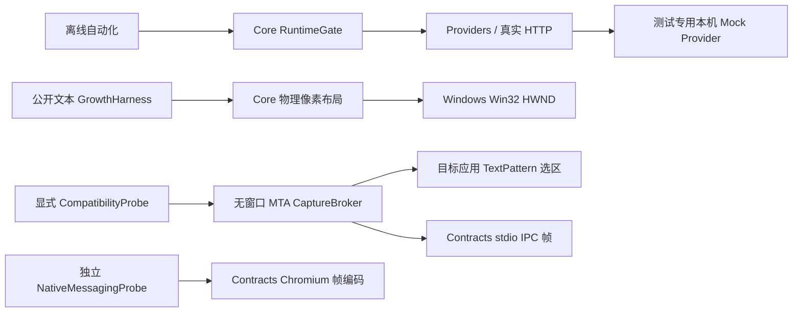

# 当前实际架构与生产缺口

本文件描述已落地的 P0 切片；正式产品仍以 SPEC 的模块和阶段为准。

- Core：纯状态/身份门控与布局，net10.0，无 WPF、模型请求或用户内容持久化。请求替换/停用取消旧身份；实际每次发送由统一门控原子启动，响应再检查身份。还未交付完整多任务 coordinator/会话版本库。
- Contracts：内部 IPC 和 Chromium Native Messaging 是两个独立编码器，先校验无符号长度再分配。图像重组属于单连接串行所有权，有界内存、索引、摘要与 30 秒绝对截止；Commit 仅交付字节，不启动模型。实际 named pipe ACL/session/角色授权尚未实现。
- ImageChunkWire：规范 Chunk 外壳、190KiB 原始分片、完整 UTF-8 消息再限界，严格 ID/索引/字段/base64 验证后进入重组；错误清除未完成传输。整条 JSON→解码→20MiB 重组→摘要 Commit 已离线验证，浏览器 NativeHost 与图像像素/格式验证仍未接入。
- Providers：每请求独立凭据头，禁自动重定向；双协议 JSON/SSE、有限重试、总/首包/空闲截止、输出限界与晚到门控。Anthropic 按开始/活动块/最终原因/结束校验，只暴露 text 块。SecretLease 仅内存访问，不替代 DPAPI；端点风险设置、能力选项、完整错误 UI 和两阶段图片流水线尚未接入。
- 接收合同：产品消费应使用 GenerateEnvelopesAsync，将完整 RequestIdentity 与每个事件一起放入 ProviderEventReceiver。目标 SynchronizationContext 由宿主提供；队列实际执行时通过 Core.TryApply 原子检查身份并应用，不能只在入队前检查。应用回调必须短小同步、不等待或再次跨线程 dispatch。当前已有队列与真实 HTTP 集成测试，正式 WPF App 尚未交付，不能将合同测试称为 UI 验收。
- 信封入口在身份锁内关联任务与调用方取消，防止当前 CTS 被并发替换/释放的竞态；调用方不传令牌也默认响应 Off/Stop/Lock/换文取消。低层 GenerateAsync 的调用方自行关联取消，只用于受控传输/故障测试或明确管理生命周期的代码，不能绕过完整接收边界接入 UI。
- Windows：Win32 坐标/监视器/窗口 Region/完整性级别实际 PInvoke。WPF 及 UIA 属于 Windows 框架，桌面实际验证不能由交叉编译代替。
- CaptureBroker：当前为 P0 一次性进程协议，真实 UIA 在 MTA 获取；父进程以硬终止处理无法取消的 COM 阻塞。仍需连接生产采集手势、状态 epoch、长驻 broker 重启/熔断、授权复制兼容与安全 IPC。
- tools：Mock Provider 只供测试；GrowthHarness 是公开固定文本视觉实验；CompatibilityProbe 对公开文件实际选区比对；NativeMessagingProbe 是显式 echo 实验。均不作为完整快译 App 的替代品。生产项目不引用测试工具。

解决方案有 11 个实际可构建项目。未创建空 App/Shell/OCR/扩展接口来冒充完成：正式 WPF App、托盘/设置/热键/DPAPI、OLE、ImageWorker、ShellExtension、浏览器扩展/NativeHost、安装/身份包仍是明确待实现模块。P0 真实平台退出门槛与其必要的 Windows/原生工具链证据仍为 Blocked。

可运行的检查及失败修复见 progress.md，Windows 操作和限制见 windows-probes.md，176 个规格条目见 traceability.json。所有 A—L 整体用例保持 NotRun。
