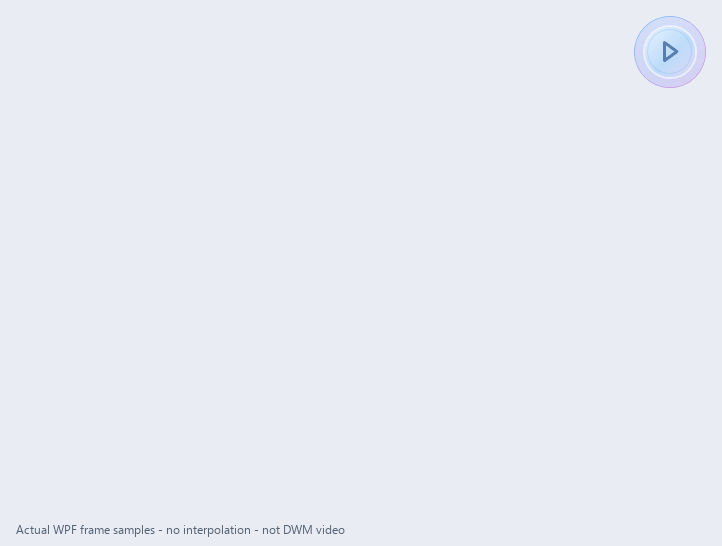
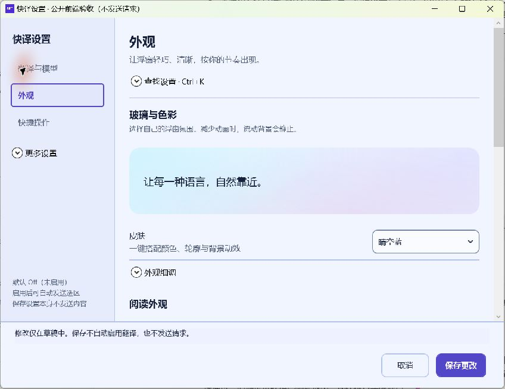

# 快译前端阶段审阅包 · 2026-11-04

开发分支：`codex/desktop-refinement-20261104`。本批在 main `cb0fcfe797ab9609f3206da1c14a8d644bd0c657` 上继续开发；不表示整个产品或完整前端已经验收。

## 先看这三份材料

### 最新正文与轮廓：真实 WPF 内容末帧

这是实际应用视图的 WPF 渲染采样，保留透明像素；不是 AI 效果图，不包含桌面背景和 DWM 合成。正文为固定公开测试样本，没有读取其他应用或调用模型。

另附[同一视觉方案的桌面窗口截图](../test-evidence/frontend-desktop-2026-11-04/reading-type/desktop.png)：截图在增加显示节奏控制前获取，布局与字体相同，不能当作最新动效证据。桌面抓图与 WPF 原始帧的像素尺寸／采样方式不同，不应混同分析文字清晰度。

### 最新文字出现与窗口生长

40 张实际 WPF 内容帧，采样时段 3813 ms，末帧额外停留 1200 ms。没有生成或插值画面；背景画布和英文标识仅用于排布样本。**不是 DWM 桌面录像，不证明帧率或没有卡顿。**

[四阶段联系图](../test-evidence/frontend-desktop-2026-11-04/reading-reveal/motion/contact-sheet.png) · [逐帧几何与时刻](../test-evidence/frontend-desktop-2026-11-04/reading-reveal/motion/frames.json)

### 设置精简：真实桌面窗口截图

已实际点击切换到外观页：三项主入口为翻译与模型、外观、快捷操作；其余四类折进更多设置。皮肤与预览直接展示，外观细调折叠。随后模型页还将协议／认证等放入连接细节，后一步已编译，未另拍模型页截图。测试使用隔离草稿，无真实 API Key。

## 项目是什么

快译是 C#/.NET 10 + WPF/Win32 原生 Windows 翻译工具。收起时为可拖动的 48 DIP 启停锚点；选区／拖入文字触发翻译，支持图片／截图与 OCR 等链路。流式译文从锚点旁展开并随内容增高，保留复制、原文展开、本次会话版本、翻译风格与模型连接设置。

默认未启用。请求与来源经过原有授权门控，隐藏／停止／清理有独立语义。仅内存描述本地保留方式，不表示内容不会发送到模型服务。多项平台路径仍处于开发验证阶段。

## 本阶段设计与实现

- 方向从深色／白色卡片调整为浅蓝主色，搭配薄荷、淡紫、浅粉的玻璃风格表面。
- 刺眼绿色实心锚点改为 36 DIP 玻璃圆珠视觉，外层点击区域仍为 48 DIP，图形区分启停。
- 云朵、流体、泡泡等轮廓和 WPF／原生区域接线；当前透明窗口关闭 DWM 外框，避免灰色矩形底框。**当前材质是自行绘制的玻璃风格，并非已验证的桌面实时磨砂模糊。**
- 阅读顶栏精简为风格、复制、更多；生成时有停止入口。重译、设置、收起等保留在更多菜单。单版本隐藏版本按钮，原文展开后才显示复制原文。
- 原文开关、复制原文和版本操作采用有边界的按钮。当前截图是原文折叠状态，不据此声称展开态已完全验收。
- 现代字体采用等线中文／Segoe UI Variable 英文，保留系统字体选项。公开预览使用16 DIP正文、1.55倍行高、460 DIP窗宽；空段落间隔约12 DIP。示例去掉测试标题和硬换行；真实译文／原文结构不被擅自重写。
- 提供晴空蓝、樱花云、薄荷海岸、暮光紫、蜜桃日落、夜色石墨等预设。选皮肤会搭配明暗、轮廓、动效与阅读规格。**按钮／锚点等颜色尚未全部按同一皮肤变量联动，仍需评审与完善。**
- 设置默认三项主导航，搜索／细调／连接和请求参数渐进展开，保留隐私、恢复和错误定位入口。
- 新显示层缓和网络大块输出，33 ms调度，按当前已收到文本的完整字符边界前进；保存与复制仍使用原完整结果。原220／180／80 ms动画与250／600 ms取词预算保留。

## 验证边界

| 项目 | 当前证据 |
| --- | --- |
| 最新构建 | SDK10.0.402，0警告、0错误，[日志](../test-evidence/frontend-desktop-2026-11-04/review-validation/reading-reveal-build.log) |
| 显示节奏 | 4项纯状态测试通过，[日志](../test-evidence/frontend-desktop-2026-11-04/review-validation/reading-reveal-tests.log) |
| Markdown／Overlay相关回归 | 569项托管测试通过，[日志](../test-evidence/frontend-desktop-2026-11-04/review-validation/reading-reveal-regression.log)；不等同真实WPF全链路 |
| 最新公开流 | 完整输出，Errors空，ModelCalls=0，AnchorStable=true，[摘要](../test-evidence/frontend-desktop-2026-11-04/review-validation/reading-reveal-01.csv.summary.json) |
| 原生焦点 | 浮窗测试为工具窗枚举适配；主动检查使ForegroundUnchanged=false。不宣称生产非激活行为通过 |
| 宽设置回归 | 先前292项中260通过、32失败，[原日志](../test-evidence/frontend-desktop-2026-11-04/review-validation/aurora-settings-tests.log)保留；缺失构建产物及文件权限／替换问题未全部排除 |
| 未完验证 | 完整皮肤保存往返、恢复／首次连接向导、混合DPI、实时网络突发与长代码／表格、流中切换／停止、透明窗口性能与命中测试 |

## 请重点审阅

1. 云朵是否仍像波浪矩形，凹口是否生硬；如何保持连续曲率和规则的阅读安全区？
2. 中文等线是否偏细、英文搭配是否协调；行长、孤行、段间距及状态行是否舒服？
3. 精简后的工具栏有没有难发现的操作；原文／复制／版本应怎样组织更自然？
4. 三项主设置是否真的容易上手；首次配置模型还可以减少哪些决策和术语？
5. 皮肤怎样统一按钮、锚点、背景和边框，而不是仅换渐变？
6. 文字出现与容器生长如何更自然，同时保持响应、锚点稳定和文字清晰？

请把可从图片观察的问题与必须实际运行才可判断的问题分开。不要建议删除必要授权提示，也不要默认改变既定Esc语义或动画时序。

### 历史对照（不是当前版本）

[早期深色／绿色锚点](../test-evidence/frontend-desktop-2026-11-04/aurora/cloud-before-polish.png) · [早期浅蓝但顶栏仍拥挤](../test-evidence/frontend-desktop-2026-11-04/skyglass/desktop.png)

本包图片均为实际程序输出，未将 imagegen 配色参考混作运行截图。研究过程见[参考来源](../validation/frontend-design-references-2026-11-04.md)。
