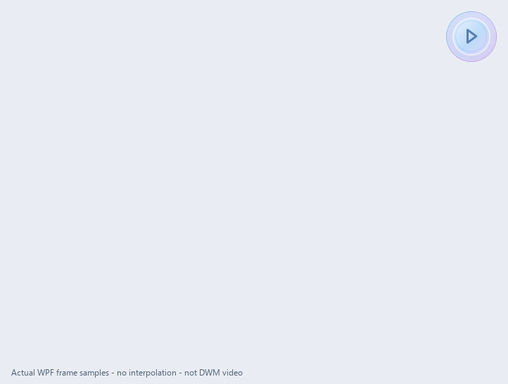

# 快译前端第二轮审阅包 · 2026-11-05

本轮基于 `eb05af1` 之后的修复，发布至开发分支 `codex/desktop-refinement-20261104`；main 保留上一轮版本。请勿将旧图片包里的花边轮廓、皮肤覆盖偏好、显示长尾直接当作本轮仍存在的事实。

## 最新画面

所有画面来自公开固定样本，不是AI效果图。GIF为41张真实WPF内容帧，采样3725ms，末帧额外停留1200ms，无插值；不是DWM录屏或FPS证明。桌面截图与WPF帧采样尺度不同，请用原始末帧判断文字细节，不用缩小预览推断字体缺笔。

## 自上一审阅基线后的改动

1. 皮肤只换配色，不再覆盖字体、字号、宽度、明暗、轮廓、背景动效或减少动态偏好。
2. 显示层积压改为约180ms后在下一刷新追平，Complete立即显示已接收内容；不承诺UI线程阻塞时的硬墙钟上限，计时从显示层观察到积压开始。
3. 收起恢复常驻；窄边/大字情况下用额外工具行保留停止、收起、更多。
4. 顶栏/原文控件完整进入边界后才显露、命中；原文的布局占位保留。
5. 已收完但请求未结算时显示“正在收尾”，不延迟底层结算或取消。
6. 正文固定排版宽度完整进入窗口后，才随最后的留白显露；首行高度不足时不显示。保留220/180/80ms数值，不缩放正文；显露相位已调整。
7. 滚动条保留占位，仅在达到布局最大高度、几何追平且确有溢出时显示。长文达到上限后的交互仍待扩验。
8. 云朵主体由重复椭圆并集改为13节点固定Bezier闭合曲线，主体相邻段切线一致；无96DIP拓扑切换。锚点并集和窗口裁剪仍保留，不宣称全局曲率连续。
9. 顶栏分隔内缩、减淡；外观主页可选圆角方框、柔和云朵、流体、气泡。最后入口/文案修改已编译，未新拍设置截图。

## 本轮证据与仍需审阅处

- [验证日志目录](../test-evidence/frontend-desktop-2026-11-05/continuous-outline/validation)：锁定SDK10.0.402编译0W0E；569项相关托管回归、14项显示/顶栏测试、2240组WPF几何/字体参数检查通过。测试范围不同，不能合并成整体产品验收。
- 实际公开窗口输出完整、Errors空、ModelCalls=0、AnchorStable=true；测试前后无残留/重复进程。
- 41帧的`ProseHorizontalContained`全部true。已检查frame014正文尚未显露、frame020句首完整且没有半原文按钮/临时滑条。此为采样证据，不证明每帧或所有场景。
- 新轮廓是否过于平、是否仍缺少辨识度，请结合本轮图提出具体控制点/弧度建议，而不是继续评价上一轮的重复鼓包。
- 继续评估句首显露时机、辅助操作区的完整性、常驻收起、视觉节奏，以及字体重量和中英混排。
- 统一皮肤颜色角色、真实组件预览、首次连接流程、普通段落增量追加仍未完成。
- 长文滚动、向上/平衡展开、大字与混合DPI、完整48DIP命中、透明凹口穿透、真实网络突发和焦点仍需独立实测。

请按“图片中已观察到／代码可确认／需实机验证”区分建议，列出下一轮最优先的3项具体修改。保留已经修好的部分，保留启停/收起的不同语义、Esc局部菜单退出、48DIP锚点、原动画时长、250/600ms取词预算以及授权/密码/来源/取消清理边界。

详细实现记录：[连续轮廓](../validation/continuous-outline-2026-11-05.md)、[完整控件](../validation/whole-controls-2026-11-05.md)、[第一批源码反馈落实](../validation/frontend-review-followup-2026-11-05.md)。
