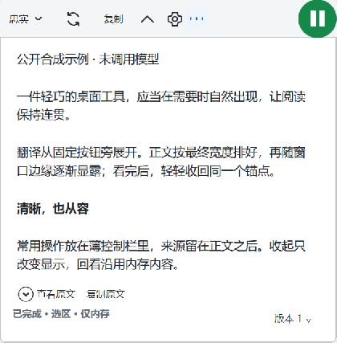
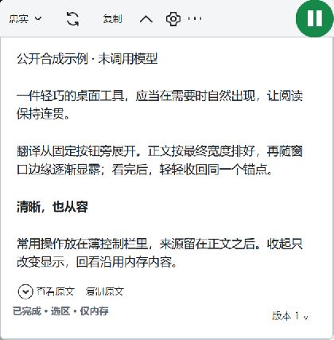
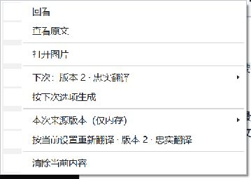
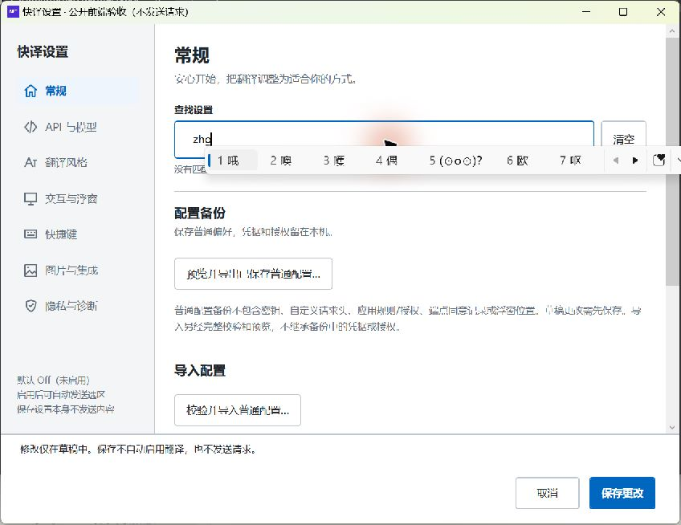
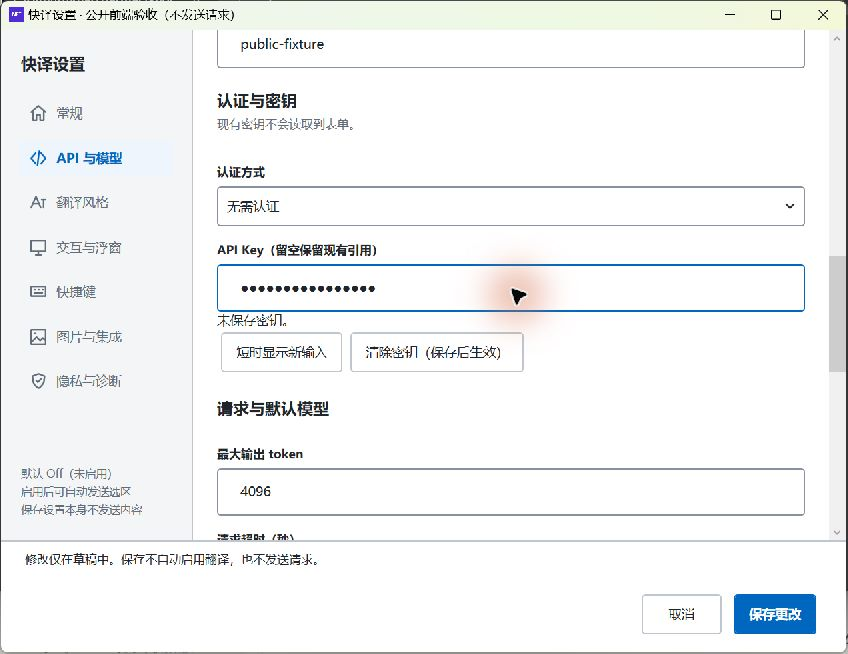

# 快译原生前端修整与 Windows 实测

本轮依据 `docs/design/快译前端设计修改方案.docx` 继续实现原生桌面小工具浮窗。当前交付为候选 B，**前端整体仍为 InProgress**。本轮重新编译了包含最新 Escape 修正的代码；没有沿用旧 SDK401 编译结果作为新版成绩。候选 A 证据保留为本轮早期切片。

## 来源与环境

- 开始时 `main`、`origin/main` 均为 `cb0fcfe797ab9609f3206da1c14a8d644bd0c657`，工作区没有未提交或未跟踪文件。获取远端后没有新增提交，`git merge --ff-only origin/main` 返回 Already up to date。
- 开发位于 `codex/desktop-refinement-20261104`。保留原 DOCX、规格、依赖锁及历史证据，没有覆盖用户已有改动。
- 读取了 DOCX 正文与全部 47 个内嵌图像，并按原生单阅读面、薄控制缘、中文排版、短菜单、来源与键盘边界核对。图版为设计参考，不是软件运行截图。
- DOCX SHA256：`cfe55dbc74e34b02da650e24e943f375048bfa5e96606d6ca5619288f5645a14`，本轮未改。
- Windows 11 x64，OS build `22631`；实际探针显示单屏 `2560×1528` 工作区、DPI `150%`、WPF RenderTier 2。
- 默认系统 `dotnet` 只有 .NET 7 运行时。本轮从微软官方获取锁定的 SDK **10.0.402** ZIP，按官方 SHA512 校验后解压到忽略目录 `artifacts/local-tools/dotnet-10.0.402`。实际运行时为 **10.0.13**，没有修改 `global.json`，没有执行证书信任或安装原生集成。

编译来源及产物摘要见[候选 A 源码清单](../test-evidence/frontend-desktop-2026-11-04/candidate-a-source.json)。由于候选含未提交源码，基线 commit 不能单独代表当前二进制；应同时核对清单中的源码和 App DLL SHA256。

## 最新候选 B

当前准确源码、测试源码和 App DLL 摘要见[候选 B 清单](../test-evidence/frontend-desktop-2026-11-04/candidate-b-source.json)。在候选 A 之后又完成了以下两项修复：

1. 真实 WPF 回归复现嵌入代码的水平 ScrollBar 被正文隐式样式影响：控件方向 Horizontal，但 Track 变成 Vertical，宽度仅 17.33 DIP。将细模板限定为纵向后，原回归通过，水平 Track 恢复 Horizontal、宽度 353.33 DIP。纵向滑块保持细条并提高普通态可辨度。见[失败原件](../test-evidence/frontend-desktop-2026-11-04/candidate-b-scroll-red.json)与[修复结果](../test-evidence/frontend-desktop-2026-11-04/candidate-b-scroll-green.json)。
2. 原文折展不再被当作新增正文。新正文显示“有新内容”，停止等终态变化单独显示“状态已更新”，显式回到底部清除提醒。新增三例首次为 2 Fail／1 Pass；中间方案又触发原停止提醒两例失败，保留原断言后补齐状态提醒语义，并新增第四例。当前原 565 例加新 4 例共 **569／569 Pass**，0 skip。见[当前日志](../test-evidence/frontend-desktop-2026-11-04/candidate-b-provider.log)、[初始红测](../test-evidence/frontend-desktop-2026-11-04/candidate-b-unread-red.log)和[停止提醒失败](../test-evidence/frontend-desktop-2026-11-04/candidate-b-stop-notice-red.log)。

候选 B 重新编译 **0 警告、0 错误**，并重新通过原 **18／18** WPF 动效阶段，关闭及清理确认。见[构建日志](../test-evidence/frontend-desktop-2026-11-04/candidate-b-build.log)和[阶段结果](../test-evidence/frontend-desktop-2026-11-04/candidate-b-overlay-stages.json)。Core 75 例及设置四场景结果仍分别属于下方对应切片，不将它们冒写成新的重复运行。

实际桌面再次展开原文并按无菜单 Esc 后，原文仍在，没有出现错误的“有新内容”。[交互记录](../test-evidence/frontend-desktop-2026-11-04/candidate-b-interactive-observations.json)同时保留未解决的键盘滚动／焦点问题；没有因此签收完整键盘流程。候选 B 公开测试进程已正常退出，Errors 为空、ModelCalls 为 0。

## 已实现的修改

| 部位 | 当前行为 | DOCX 对应 |
|---|---|---|
| 中文字体 | 正文、原文、表格及外壳优先使用 Windows 微软雅黑 UI，避免中文回退成衬线字；代码保持 Consolas | §11、16、23 |
| 控制栏 | 回看、停止、重生成采用统一线性图标；收起箭头朝向锚点；更多使用矢量图形；中文可访问名及稳定 Tag 保留 | §5、6、22、K23 |
| 阅读滚动条 | 固定保留系统滚动列，只显示细滑块；短内容不显示无效滑块，避免滚动条出现时正文改宽重排 | §3、4、11 |
| 更多菜单 | 补充当前控制栏未显示的动作，去掉重复项；接收开关保留原主按钮入口，不混入日常阅读菜单；保留版本、下次选项与按当前设置重译的不同语义 | §5、9、10、24 |
| 设置密度 | 普通动作按钮按内容宽度排列，减少标题下重复横线；保存、取消仍固定可达 | §17、18、28 |
| 配置初始选择 | 打开已有配置时选择当前文字配置；其不存在时选首个配置。只更新编辑选择，不保存、不启用、不发送 | §18、28 |
| 配置可访问名称 | 配置列表项读出配置名称，避免默认记录对象的完整 `ToString()` 成为读屏名称 | §22、29 |
| 原文生命周期 | 原文控件从最初父容器脱离后再组合披露区，修复真实 WPF 双逻辑父容器崩溃 | §11、24、29 |
| 新来源测量 | 测量前使离屏 RichTextBox 及其实际文档视图失效，避免短新来源复用旧长文 DesiredSize | §4、14、27 |
| 状态反馈 | 结果事件后更新回看、复制和状态栏；精简来源栏与图片版本菜单仍保留来源种类、不确定说明及实际用量 | §8、9、12、13 |

48 DIP 锚点、红 Off／绿 On、单击启停、220／180 ms 几何、80 ms 正文阶段、350／250 ms 辅助条、250／600 ms 取词预算保持原合同。密码输入、来源校验、发送门控、取消和清理继续走原生产实现。

## 候选 A 验证切片

| 检查 | 结果 | 证据及范围 |
|---|---|---|
| SDK402 Release App 与 GrowthHarness 编译 | Pass，0 警告、0 错误 | [当前构建日志](../test-evidence/frontend-desktop-2026-11-04/candidate-a-build.log)；包括此前未编译的 Esc 修改 |
| Provider 中 Markdown、Overlay、OriginalSource 相关回归 | Pass，565／565，0 skip | [当前测试日志](../test-evidence/frontend-desktop-2026-11-04/candidate-a-provider.log)；真实生产命令体与测试端口，不等于物理桌面输入 |
| Core 几何、选区软预算、阶段计时和 RuntimeGate 相关回归 | Pass，75／75，0 skip | [测试日志](../test-evidence/frontend-desktop-2026-11-04/candidate-a-core.log)；没有修改 Core 预算或几何时序 |
| 原生产 WPF 18 阶段动效 | Pass_LimitedStages，18／18；关闭、清理确认 | [完整阶段结果](../test-evidence/frontend-desktop-2026-11-04/candidate-a-overlay-stages.json)；首段展开、长文增高、收起、回看与中途反向，包含中间帧及终帧 |
| 原生未适配样式帧采样 | 1053 个记录，几何无效 0，前台变化 0 | 同次动效原始帧保留于 `artifacts/frontend-20261104-stages-final/overlay-raw-frames.json`；单屏 150%，没有刷新率／完整性能签收 |
| 设置宽、窄、大字和短恢复窗口 | Pass_LimitedRaster，四场景，关闭和清理确认 | [布局结果](../test-evidence/frontend-desktop-2026-11-04/candidate-a-settings-layout.json)；原字段及固定保存取消的可达性检查。大字场景使用实际 WPF FontSize 参数，不冒充系统独立文本缩放 |
| 中文 IME、选择和替换 | 已实际观察候选窗、提交 `zh哦`、全选与替换为 `交互` | [交互记录](../test-evidence/frontend-desktop-2026-11-04/interactive-settings-observations.json)；仅隔离公开夹具 |
| 密码输入与短显 | 已观察掩码、显式短显、超时恢复、Tab 失焦恢复 | 同上；使用公开假值，未保存秘密；没有精确延迟分位数成绩 |
| Esc 局部菜单与无菜单路径 | 已观察菜单关闭、正文及已展开原文保留，更多入口有焦点轮廓 | [当前交互记录](../test-evidence/frontend-desktop-2026-11-04/interactive-overlay-observations.json)；非激活原生样式验收与此入口分开 |

实际命令使用项目内 SDK，普通构建首次使用 `-p:RestoreLockedMode=true`，后续 `--no-restore`。相关测试筛选、构建输出和 TRX 原件保留于 `artifacts/frontend-20261104-*`，没有删除失败结果或降低断言。

### 真实桌面截图

下图来自候选 A 生产 WPF 控件的 Windows 窗口捕获；候选 B 阅读截图在上方。内容均为公开合成夹具，不是模型输出、网页或设计稿。

浮窗交互入口为 `--desktop-overlay-review`。桌面工具过滤非激活工具窗，因此**只有这个测试入口**会清除 TOOLWINDOW／NOACTIVATE 并添加 APPWINDOW，方便截图及键盘操作。它使用同一生产 ShellWindow、原来源快照及原命令，但不能证明生产样式的非激活／AltTab 行为。未适配样式的 18 阶段探针没有使用此入口。

独立设置入口为 `--desktop-review`，使用专属临时配置和拒绝保存真实密钥的保护器。测试连接不可用；输入、取消和关闭未操作用户生产配置。当前交互浮窗已经正常退出，结果记录 Errors 为空、ModelCalls 为 0；设置已通过取消关闭。

### 动画关键帧

以下来自同次真实生产 WPF 内容光栅化，**不是 DWM 桌面呈现帧**。它们用于核对固定锚点、裁切和内容布局，不与上面的 Windows 捕获混写。

## 失败、定位与修复

1. 最初直接取词结果事件的回看按钮没有及时刷新，18 阶段探针在回看被禁用处失败。已使实际结果事件更新状态，原测试继续执行。
2. 未携带真实源快照的旧视觉夹具无法证明来源和复制。接上受限、无网络的实际协调器快照后，复现原文控件双父容器崩溃，已修复；不再以无来源夹具代替来源界面。
3. 图片回归原先 564 Pass／1 Fail：短状态栏丢失截图身份和不确定说明，版本菜单也丢失说明及用量。已补回；原断言未改，当前 565 全通过。
4. 第二轮动画采样的首段只有 22 字，但先返回旧长文高度 782 物理像素；第一轮同内容为 197。旧最大高度被保持后，后续无法观察长文增高。仅使外层控件失效仍失败；使实际测量视图树失效后，原 18 阶段通过，未改动 220／180／80 ms 时序。
5. 旧设置探针把底栏强制转成 ScrollViewer，而当前底栏为 Border，导致探针 InvalidCast。已改为检查真实底栏、其状态视口和常规页恢复选择器，保留可达性断言。
6. 新增默认配置选择红测复现了未选择活动配置。第一次红测的断言放在关闭观察登记前，另导致测试清理未确认；该自有进程经核验后被终止，原失败不改为清理通过。修正探针登记后，同一产品缺陷仍红且清理通过；再修产品后四场景及新断言通过。

原件保留在本地 artifacts 的 `stages`、`stages-r2`、`stages-r3`、`settings-layout`、`settings-profile-red`、`settings-profile-red2` 等目录。本报告不回填历史云端构建、SDK401 或旧 Windows 运行结论。

## 继续推进的项目

- 实测 Tab 从正文直接到版本入口；完整的控制栏→正文→来源与 ShiftTab 顺序仍需修整、复测。桌面工具的 UIA focused_element 曾保持旧值，因此没有把这个字段当作焦点通过证明。
- 原文展开误报“有新内容”已在候选 B 修复，并保留准确的终态更新提醒；新一轮桌面组合仍需继续覆盖。
- 原文展开状态文案、展开后的来源可见性与滚动定位仍需对照图 18／24 完整复核。
- 暗色、高对比、减少动画、独立 200% 文本、混合 DPI、全部四角／边缘及点击穿透仍需各自证据；单屏 150% 检查不能代替。
- 仍需完成实际复制成功／失败、反馈复位、缓存回看零新增请求和取消迟到等完整交互组合。已有逻辑测试与公开夹具不替代未执行的桌面用例。
- 当前外观是可审阅候选，尚未获得用户最终审美验收。完整 FE01—FE18、B60、安装、真实 UIA／OLE、模型质量和公众发布均未在本轮整体签收。

这些项目保持未完成，持续目标保持 active。本报告及截图不构成“前端已全部修完”的声明。
