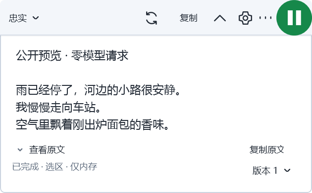
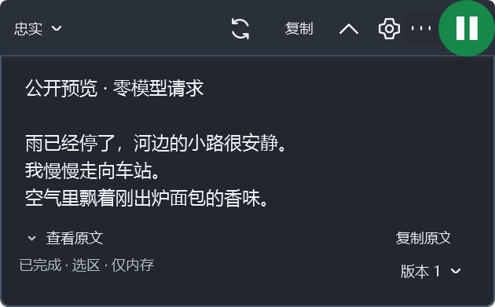
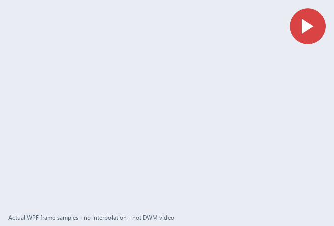

# 快译背景细节与交互动效重做

用户明确指出前一候选不仅布局有问题，背景、细节、动态和交互也没有达到要求。本轮因此以实际外观和手感重做为重点，不能把测试通过当作审美完成。整体目标仍 InProgress。

## 当前可见效果

浅、深两套仍使用一个不透明阅读面。控制缘使用有区别的中性表面、轻分隔及 3 DIP 内部接触阴影；阴影在当前可见 HWND 内，不增加透明命中区域。正文保持原字号和约 1.55 行高。

以下是同一生产控件实际渲染的 WPF 像素帧，内容为公开合成预览，模型请求为 0。这些图片没有鼠标操作高亮，**不等于 DWM 桌面捕获**。





实际 Windows 捕获另外保留在 `candidate-d/light/reading-desktop.png`、`candidate-d/light/menu-desktop.png` 和 `candidate-d/dark/source-keyboard-desktop.png`。电脑操作指针高亮可能出现在这些桌面捕获里，不把它与控件自身的背景、悬停反馈混写。

## 已重做的细节

- 菜单使用统一的实色表面、小圆角、细边、选中填色、键盘轮廓、矢量勾选和子菜单箭头，去掉旧模板的灰色图标槽与凸边。MenuItem、ContextMenu、原命令及原生键盘角色保留；[原生模板要求的 PART_Popup 与 ItemsPresenter](https://learn.microsoft.com/en-us/dotnet/desktop/wpf/controls/menuitem)保留。
- 菜单在弹出前应用样式，后续更新资源而不重复换模板，避免打开时从旧皮肤跳到新皮肤。较长说明折行，菜单按内容组织，不铺满读取区域。
- 原文入口使用矢量细箭头与实际展开文案，共用局部按钮反馈，替换旧圆圈箭头；原文复制仍走原资格、版本及取消检查。
- 普通、悬停、按下、键盘焦点分开呈现。100 ms 局部 tint 使用无回弹 ease-out；命令立即生效，不移动主锚点或缩放文字。主填色按钮仍有可见的反色焦点环，减少动画直接换状态。
- 停止采用明确的实心小方形，等待采用单段轻量进度环。状态与名称仍同时可辨；主开关红绿和 48 DIP 规格保留。
- 版本入口改用矢量箭头，状态栏减轻字重；提示说明限制宽度并折行，避免长技术说明横穿整个浮窗。
- 小字号采用 Display 文本排版；未显式指定字号的控件具有可随文本倍率变化的基线。

## 生长与交互改变

原半径算法在扩出 48 DIP 后就直接到 6 DIP，整个展开的大部分时间圆角不再变化。现在 CornerProgress 和几何共用原 220／180 ms 曲线，从当前形状反向继续；流式增高时保持已展开形状。WPF 表面裁切与原生区域使用同一量化半径，控制缘不再露出方角。

控制栏也按最终屏幕位置排版，通过逐帧可见区域显露，避免按钮随左边界滑移。主要动作分组与风格之间有稳定留白，主按钮不动。上生长的等待文案跟随锚点所在控制缘。

等待条之后第一次正文从 0 开始使用原 80 ms 淡入，避免继承等待条的不透明度而突然出现。首批 220 ms、收起 180 ms、正文 80 ms、250／600 ms 取词预算未被替换。

### 实际运行帧序列



这是实际生产 WPF 控件的 29 个像素采样，约 1008 ms 的采样区间；最后另加 1200 ms 静止展示时间。没有按几何生成替代画面、没有插值帧。外侧中性底板和说明文字只属于导出预览，不是产品背景。该序列**不是 DWM 录像，也不是帧率或性能签收**。

可重复的采集入口：

```powershell
# 使用锁定 SDK 构建 GrowthHarness 后，选一个不存在的输出前缀。
dotnet KuaiYi.GrowthHarness.dll --desktop-overlay-review <new-prefix> light full 1 motion
# 正常关闭窗口后编码；该可选审阅工具需要 Pillow，不是产品依赖。
python tools/KuaiYi.GrowthHarness/encode-motion-preview.py <new-prefix>.motion <new-output-directory>
```

深色使用 `dark`，减少动画使用 `reduce`，测试窗口自己的文本倍率可用 `2`。倍率注入只影响隔离的测试窗口，不改变系统显示设置，不能替代系统文本通知与混合 DPI 验收。

## 键盘与来源实测

原生焦点记录先确认点击正文确实获得了 RichTextBox 焦点，旧 UIA focused_element 报告不可靠。默认正文 Tab 模式为 None，会跳过来源控件；Continue 仍会被外部 TabIndex 越过。改为 Local 分组，并让控制栏顺序对应实际位置后，实际验证了：

1. 正文 → 原文入口 → 复制原文 → 原文只读文本。
2. ShiftTab 按相反顺序返回正文，再返回更多入口。
3. 主按钮与风格、重新生成、复制、收起、设置、更多的正反向顺序。
4. Space 展开原文；Enter 打开更多；Right 进入子菜单；Esc 先退子层，再退主菜单；无菜单 Esc 保留正文与已展开来源。
5. 开启只读光标后，CtrlEnd／CtrlHome 能滚到文档末尾／开头。深色新披露模板再次验证了 Tab 到原文与自动滚入可见区。

记录只在固定公开夹具中收集导航键、焦点类型、命令名、滚动和字号等元数据；不记录普通字符键入。旧早期记录包含修饰键，仍不含正文键入内容。见 `candidate-d/keyboard-*.jsonl`。原密码、来源、网络授权和取消门控没有绕开。

## 本次验证与限制

| 范围 | 结果 |
|---|---|
| SDK 10.0.402 构建 | 0 警告、0 错误；见 `candidate-d/build.log` |
| 相关生产命令、来源、Markdown、颜色回归 | 573／573 Pass，0 skip |
| 相关 Core 几何、预算、门控及新增圆角／淡入 | 79／79 Pass，0 skip |
| 最新原生 WPF 18 阶段动效 | Pass_LimitedStages，18／18；关闭及清理确认 |
| 新表面下的长代码横向滚动 | 实际 WPF 回归 Pass |
| 浅、深实际预览 | 原窗口正常退出；Errors 空，ModelCalls 0 |

构建、日志、原生阶段和准确源码摘要见 `candidate-d` 证据目录。一次并发构建发生共享 Core 输出文件锁，后续已改为串行；失败日志保留，未修改测试断言。颜色数学检查证明必要色对可读，不证明外观已经被用户认可。

初次运行帧采样曾把等待条当成完成终点，之后又捕获到传输清理期间的停止按钮；这些草稿保留。当前 `review-light` 终点要求正文可见、原生控件状态与完成一致、几何已收敛。旧根目录及 `light` 下的早期采样不作为最新结果。

桌面工具无法直接操作非激活工具窗，所以交互预览仍使用测试专属原生样式适配；未适配样式的阶段检查独立进行。本文不把适配入口签为完整原生焦点验收。

当前仍须继续：新版独立文本放大与减少动画组合、实际高对比／混合 DPI、全部位置的真实命中、实际复制反馈及更多来源组合。外观需继续按用户反馈打磨，完整前端及产品验收未完成，持续目标保持 active。
